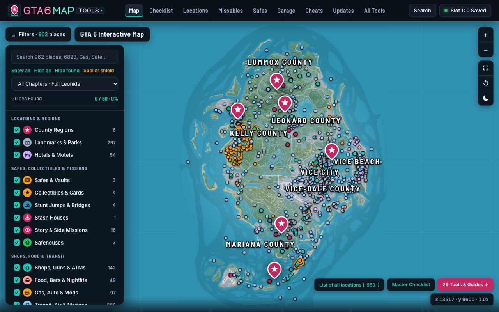

# GTA 6 Map Tools — Interactive Leonida Map & Companion Guide

**GTA 6 Map Tools** ([https://gta6maptools.com](https://gta6maptools.com)) is an independent, dark-mode second-screen companion toolkit built for *Grand Theft Auto VI* console players on **PlayStation 5**, **PS5 Pro**, and **Xbox Series X|S**.

## Why We Built This Companion

Playing a massive open-world game on a TV shouldn't require scrubbing 40-minute video walkthroughs or signing into sluggish desktop wikis. GTA 6 Map Tools focuses on:

- **Zero Forced Login:** All checklist progress saves locally in your browser across **3 independent save slots** with 1-click JSON export/import ([schema included here](progress-backup-schema.json)).
- **Dark-Room Mobile Ergonomics:** High-contrast dark asphalt UI engineered for phones and tablets sitting next to a controller.
- **Strict Verification & Separate Counters:** Every guide pin carries explicit verification metadata, and we never mix the **35 in-game 100% goals**, **55 PS5/Xbox trophies**, **200 WAiNK base-model vehicle scans**, and **61 post-story cheat slots**.

---

## Quick Tool Index

| Tool / Guide | Direct Link | What It Solves |
|---|---|---|
| **Interactive Leonida Map** | [gta6maptools.com](https://gta6maptools.com/) | Zoomable terrain atlas (up to 28x), 960+ landmarks & gameplay pins, category filters, Hide Found & Spoiler-Free toggles |
| **Safe Codes & Doorway Guides** | [gta6maptools.com/codes](https://gta6maptools.com/codes) | Verified keypad safe combinations (Brooks Boatworks `6823`, La Cascara Motel `6969`, Kingpin Bowling `0300`, etc.) with exact entrance directions |
| **Chapter 1 & 2 Missables Checker** | [gta6maptools.com/missions/missables](https://gta6maptools.com/missions/missables) | Point-of-No-Return cutoff tracker for *Tourist Trap* (Ch. 1) and *Checking Out* (Ch. 2) |
| **All-in-One Master Checklist** | [gta6maptools.com/checklist](https://gta6maptools.com/checklist) | Unified completion progress tracker with local multi-slot saving |
| **100% Completion Checklist (35)** | [gta6maptools.com/100-percent-checklist](https://gta6maptools.com/100-percent-checklist) | Official 35 in-game 100% completion requirements (+ printable A4 / US Letter view) |
| **Port Gellhorn Regional Map** | [gta6maptools.com/locations/port-gellhorn](https://gta6maptools.com/locations/port-gellhorn) | Deep early-game regional guide covering safes, stash houses, and doorway approaches |
| **PS5 & Xbox Cheat Codes (61)** | [gta6maptools.com/cheats](https://gta6maptools.com/cheats) | Post-story cheat slot tracker with PS5 (`L1+R1`) and Xbox (`LB+RB`) icon toggle |
| **18-Slot Garage & Vehicle Tracker** | [gta6maptools.com/vehicles/garage](https://gta6maptools.com/vehicles/garage) | Track registered vehicles, security tracker tiers, and WAiNK scans |

---

## Local JSON Progress Backup Format

Your progress on [My Progress](https://gta6maptools.com/progress) is stored strictly in browser `localStorage` under `gta6mt_progress_v1` and can be exported/imported as plain JSON at any time. See [`progress-backup-schema.json`](progress-backup-schema.json) for the documented public schema.

## Reporting Corrections & New Locations

Spot a new safe combination, entrance shortcut, or coordinate fix?
- Submit via our [Report a Correction](https://gta6maptools.com/contact) page, or
- Open an Issue in this repository with the region name, landmark description, and platform (`PS5` / `Xbox Series X|S`).

## Non-Affiliation Disclaimer

*GTA 6 Map Tools* is an independent, fan-made player companion project and is **not affiliated with, endorsed by, or sponsored by Rockstar Games or Take-Two Interactive Software, Inc.** *Grand Theft Auto*, *Grand Theft Auto VI*, *Vice City*, and *Leonida* are trademarks of Take-Two Interactive Software, Inc. Community terrain geography retains upstream **CC BY 4.0** attribution ([Data Sources & Credits](https://gta6maptools.com/sources)).
